# Splunk Enterprise

## Background
Building a strong investigative mindset in a Security Operations Center (SOC) starts with visibility and context mapping—understanding what data exists, how it is collected, and what attacker behaviors look like across the predominant vector domains such as Email, Identity, Cloud, Network and Endpoint.

## Aim
Develop an investigative mindset by querying data using Splunk queries, creating Dashboards, creating Alerts and Reports in Splunk.

### Build Objectives:
* **Dashboard – SSH Activity**: Looking into linux machines, failed login attempts, source IP, heatmapping.
* **Dashboard – Windows Activity**: Looking into aggregating successful logins by computer name, user and logon type. New user account creation, users with administration privileges, Firewall exceptions added.
* **Alert – Successful SSH Authentication**: Alerting on successful authentication activity towards our SSH server.
* **Report – SSH Server outbound communication**: Daily reporting on the top three outbound destinations sourcing from our SSH server.

## Setup
My lab is setup by creating a Linux Virtual Machine in VMware, installing Splunk, and ingesting pre-prepared data, sourced from <a href="https://www.skool.com/mydfir">THE_FORGE</a>.

[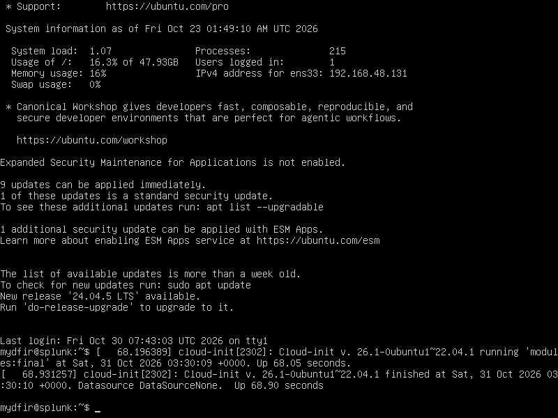](/images/Screenshot1.png)

*Screenshot 1*

[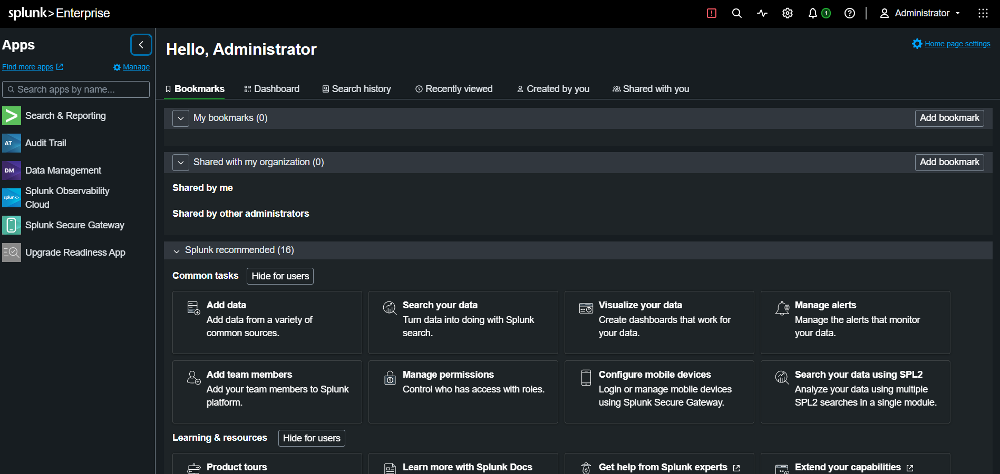](/images/Screenshot2.png)

*Screenshot 2*

[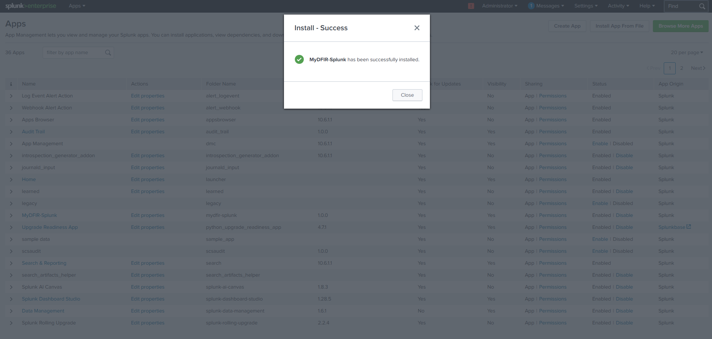](/images/Screenshot3.png)

*Screenshot 3*

[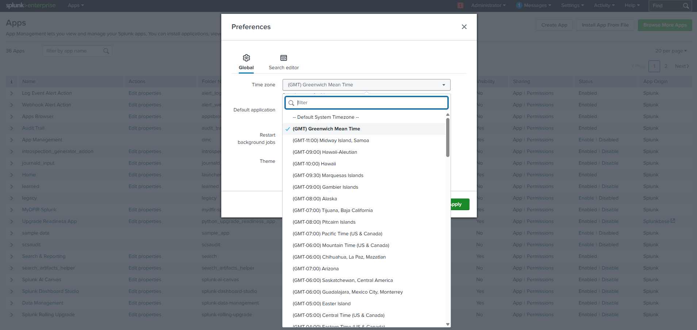](/images/Screenshot4.png)

*Screenshot 4*

---

## Writing Queries
> *Using Fast Mode to analyse broad search results helps us look for something specific within large data sets e.g. Malware, a known C2 server. You can search the IP address in fast mode then deep dive once you have confirmed that the data you are looking for is present in the environment.*

Searching best practice would be to start off by specifying the index and the time, then follow up with as many default fields as you can. Some useful default fields are already listed on the left of the screen, while others can be found by expanding an event. If we are interested in a particular field **VALUE**, we can find the related Field **NAME** by reading the Field/Value pairs of the expanded event.

[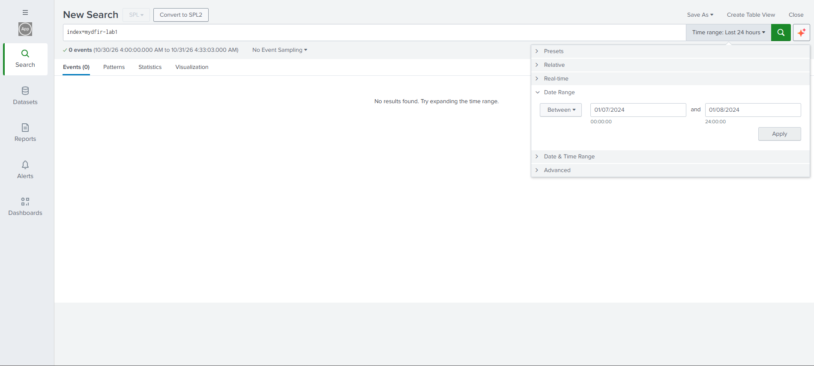](/images/Screenshot5.png)

*Screenshot 5*

[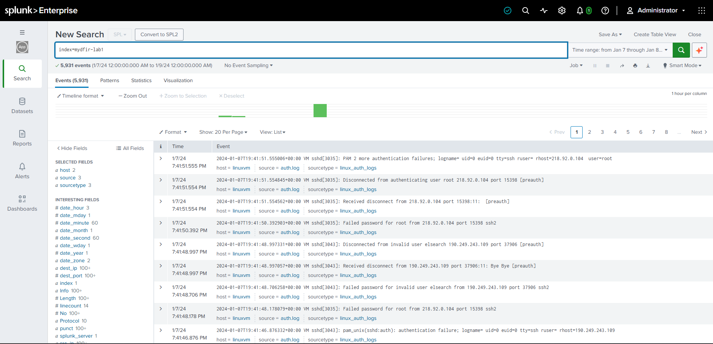](/images/Screenshot6.png)

*Screenshot 6*

Explore other sources. This identifies that something like an IP address of interest could exist under the Field names of `rhost`, `src_ip` or even `dest_ip`. This helps us build up our queries and the concept applies to all SIEMs.

Hidden fields exist and begin with an underscore before the Field Name. The main hidden field to focus on in this exercise is `_time`. 

To use a transforming command, we need to use the pipe symbol (`|`) at the end of a query. Using the example of `stats` as a transforming command, we will search for events in our `mydfir-lab1` index with a specified host, a specified source, and use the `stats` transforming command to provide statistics grouped by a field—in this case, how many times a specific IP address has been found in our environment. The `stats` command does this by counting each event that includes the specific destination IP in our query.

**Example Query:**
```spl
index=mydfir-lab1 dest_ip=104.248.150.105 host=linuxvm source="linuxvm-netlogs.csv" 
| stats count by src_ip, dest_ip
```

The order in which you write your transforming commands will be mirrored in the output.

[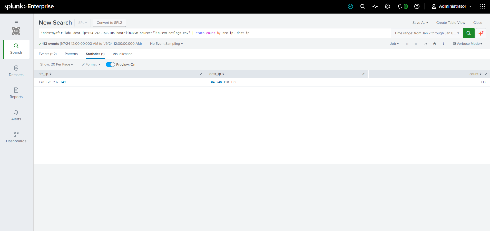](/images/Screenshot7.png)

*Screenshot 7*

A transforming command like `table` will provide responses in table format instead of grouped like the command `stats` does. A transforming command like `table` will also provide the output in the format stipulated regardless of whether or not a Field Name exists. However, if the Field Name does not exist or the spelling does not take into account case sensitivity, no data will present under the column. This is your clue to look at case sensitivity and the accuracy of the field name.

---

## Creating Dashboards

### Dashboard 1: Linux SSH Activity
In this instance, we’ll look at successful and failed SSH login attempts on Linux machines.

Navigating to: `Admin page` ➔ `Apps` ➔ `MyDFIR Splunk` ➔ `Search Field`, we start a Splunk query:
```spl
index="mydfir-lab1" failed source="auth.log" host=linuxvm sourcetype=linux_auth_logs
```

From the results, we can select the `user` field name on the bottom left if we’re unfamiliar with the `top` transforming command.

[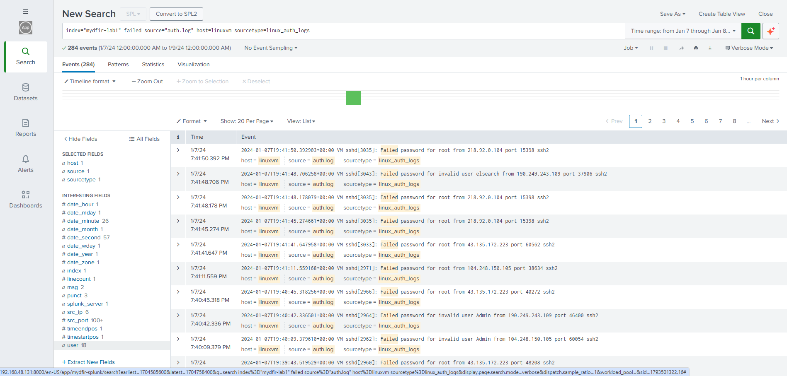](/images/Screenshot8.png)

*Screenshot 8*

Clicking on the `user` field name opens a window with pre-built reports and from here we can select `Top values` to add this to our Splunk Query. This will present the top 20 users who attempted to sign in where a failed SSH login was observed. Your Splunk query will update to:

```spl
index="mydfir-lab1" failed source="auth.log" host=linuxvm sourcetype=linux_auth_logs
| top limit=20 user
```

[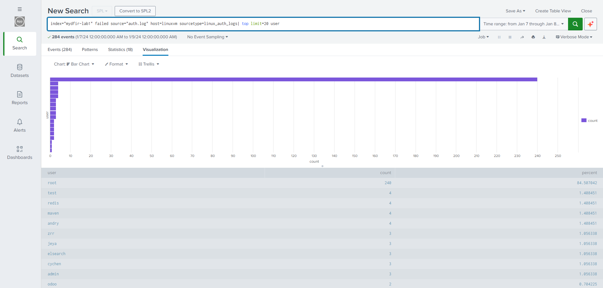](/images/Screenshot9.png)

*Screenshot 9*

Our visualization is currently set to `Bar Chart`. To change this, we select `Single Value` to reflect `root` as the top user with failed logins.

[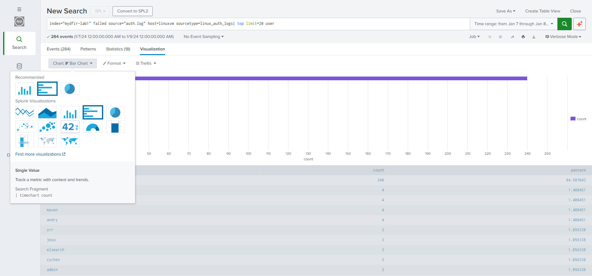](/images/Screenshot10.png)

*Screenshot 10*

[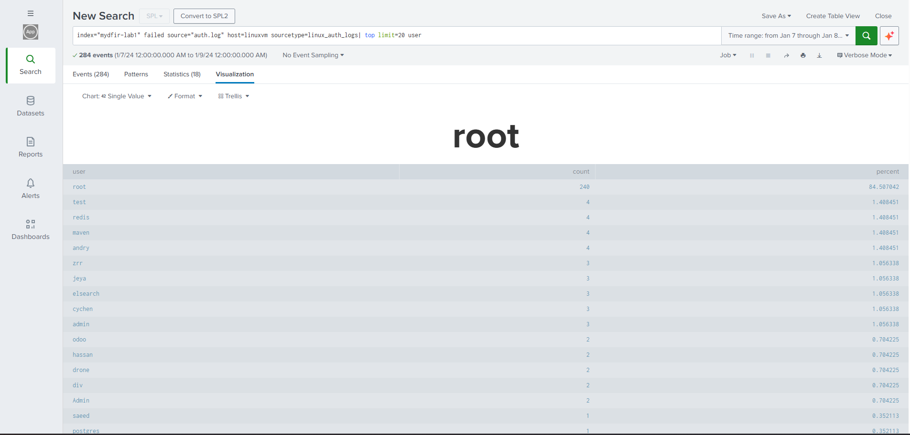](/images/Screenshot11.png)

*Screenshot 11*

To save this Dashboard as **SSH Activity**, click **Save As** on the top right, select **New Dashboard**, title the dashboard, and name the panel **Top Failed Account**.

[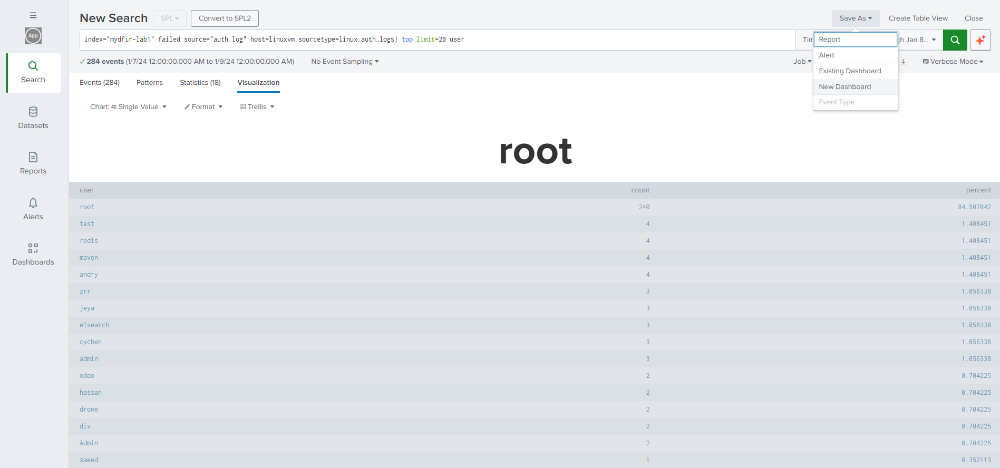](/images/Screenshot12.png)

*Screenshot 12*

[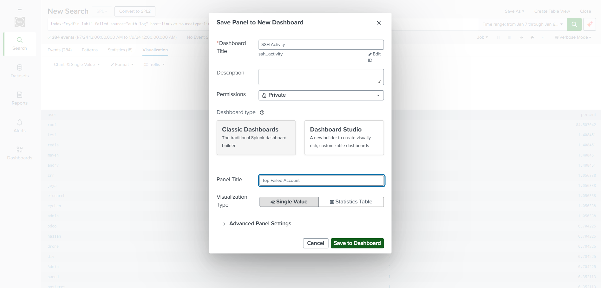](/images/Screenshot13.png)

*Screenshot 13*

To update your dashboard with new parameters such as the Source IP, add to your query:
```spl
index="mydfir-lab1" failed source="auth.log" host=linuxvm sourcetype=linux_auth_logs
| top limit=20 src_ip 
```

Click search, select **Save As**, and choose **Existing Dashboard** from the drop-down menu.

[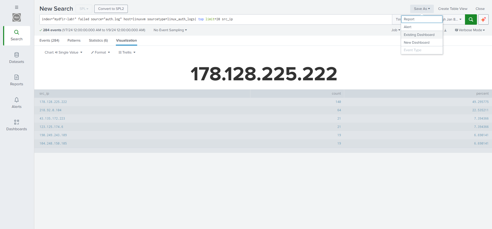](/images/Screenshot14.png)

*Screenshot 14*

Select the previously created **SSH Activity** dashboard. Adding Source IP allows the dashboard to display the top users with failed logins alongside the top source IPs attempting those failed logins.

[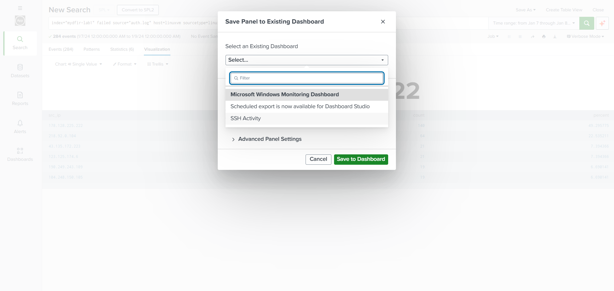](/images/Screenshot15.png)

*Screenshot 15*

To add a third transforming command to our dashboard, replace `top limit=20 src_ip` with:
* `stats count by user`: Counts the number of users with failed login attempts.
* `sort -count`: Sorts the results from highest to lowest.

Our updated query for the dashboard is:
```spl
index="mydfir-lab1" failed source="auth.log" host=linuxvm sourcetype=linux_auth_logs
| stats count by user 
| sort -count
```

Select the **Statistics** tab to focus on the raw metrics rather than a visual representation.

[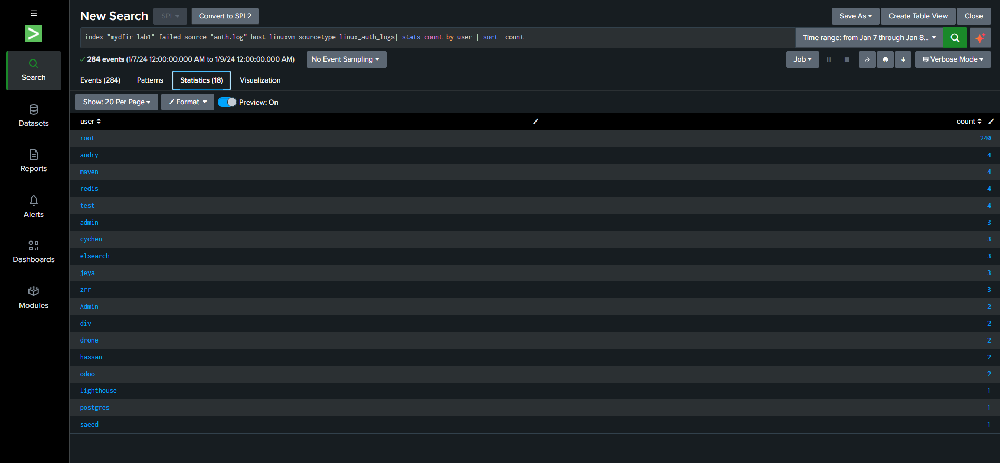](/images/Screenshot16.png)

*Screenshot 16*

Save this addition by selecting **Save As**, picking the **SSH Activity** dashboard, and naming the panel **Failed Attempts by User**.

[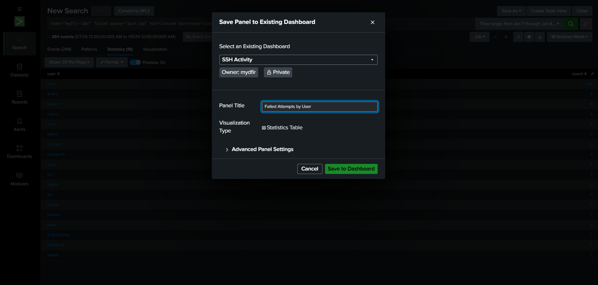](/images/Screenshot17.png)

*Screenshot 17*

To add successful logins, remove the word `failed` and clear the Transforming Commands. Check the `Interesting Fields` on the left column to narrow the search. Selecting `msg` reveals the option to isolate messages containing `Accepted Password`.

[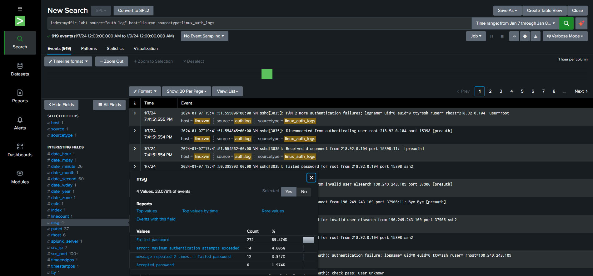](/images/Screenshot18.png)

*Screenshot 18*

After filtering by `Accepted Password`, add Transforming Commands to organize the data by timestamp (`_time`), user, and source IP (`src_ip`):

```spl
index=mydfir-lab1 source="auth.log" host=linuxvm sourcetype=linux_auth_logs msg="Accepted password" 
| stats count by _time, user, src_ip 
```

[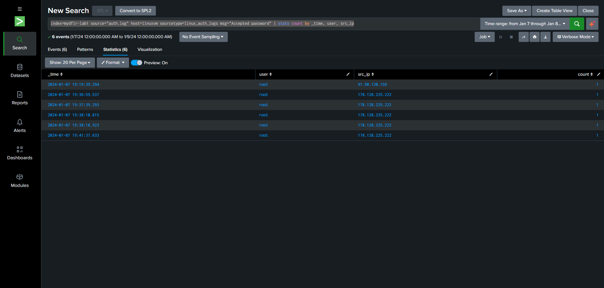](/images/Screenshot20.png)

*Screenshot 20*

To map external IP addresses to a country, use Splunk's built-in Geolocation command `iplocation src_ip`. This enriches the data with new fields like `City` and `Country`. The updated query is:

```spl
index=mydfir-lab1 source="auth.log" host=linuxvm sourcetype=linux_auth_logs msg="Accepted password" 
| iplocation src_ip 
| stats count by _time, Country, user, src_ip
```

[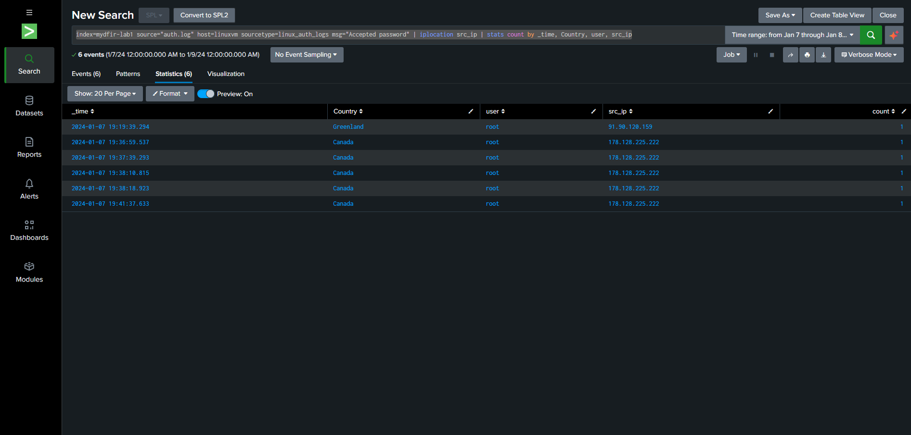](/images/Screenshot21.png)

*Screenshot 21*

#### Heatmap Creation
To map all network activity, remove the default filters (`source`, `sourcetype`, `msg`) and group `stats count` strictly by `Country`. 

Splunk uses `geom` for choropleth mapping, taking two main parameters:
1. `allFeatures`: Assigned `True` or `False`.
2. `featureIdField`: Set to an existing field (e.g., `Country`).

[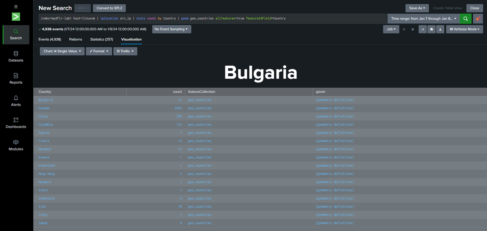](/images/Screenshot22.png)

*Screenshot 22*

Under Visualization options, select **Choropleth Map**. Under **Format ➔ Colors**, set **Color Mode** to **Categorical**.

[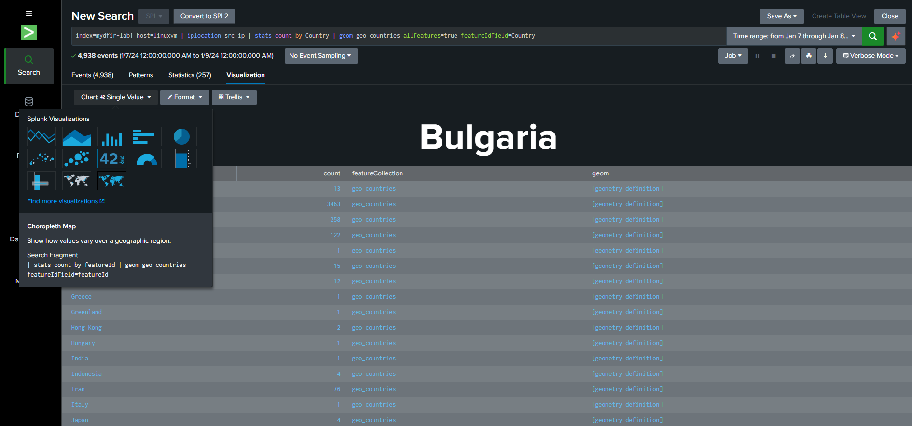](/images/Screenshot23.png)

*Screenshot 23*

[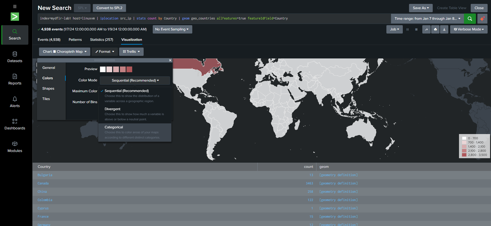](/images/Screenshot24.png)

*Screenshot 24*

[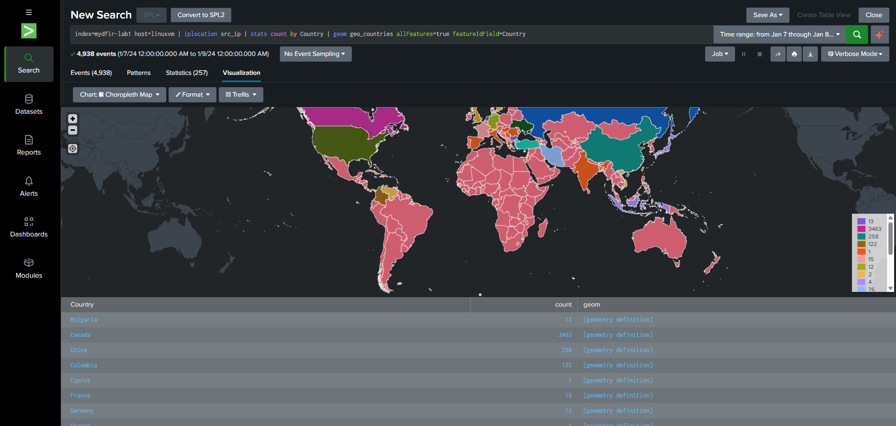](/images/Screenshot25.png)

*Screenshot 25*

Save this outcome to the **SSH Activity** dashboard under the panel name **Heatmap Network Activity**. Click **Edit** on the dashboard to adjust themes and resize panel tiles to fit neatly on one page.

[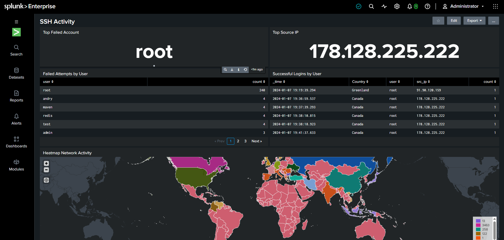](/images/Screenshot26.png)
*Screenshot 26*

---

### Dashboard 2: Windows Event Dashboard

Search with a new query targeting your chosen index. Under `Selected Fields`, select `winvm`. Windows Event ID **4624** represents a successful login event.

[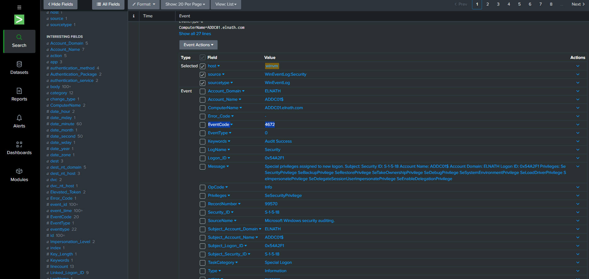](/images/Screenshot27.png)

*Screenshot 27*

Updated query:
```spl
index=mydfir-lab1 host=winvm EventCode=4624
```

Expand the event to select `user` so it remains pinned under Selected Fields.

[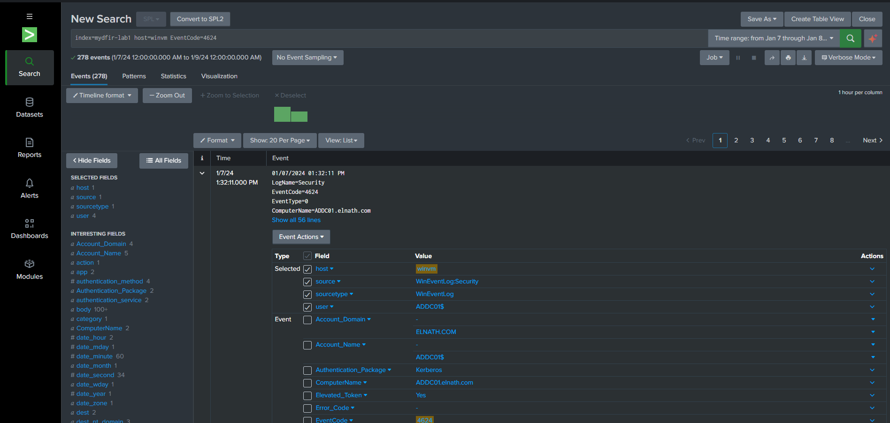](/images/Screenshot28.png)

*Screenshot 28*

Values ending in `$` (e.g., `ADD01$`) indicate system accounts. To filter out system accounts using wildcards:
```spl
user!=*$
```

Updated query:
```spl
index=mydfir-lab1 host=winvm EventCode=4624 user!=*$
```

To break down login data by computer name and logon type, add the `stats count` command:
```spl
index=mydfir-lab1 host=winvm EventCode=4624 user!=*$ 
| stats count by ComputerName, user, Logon_Type
```

[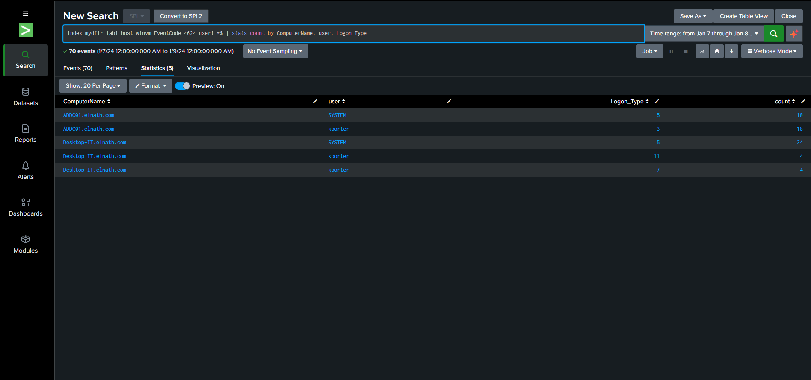](/images/Screenshot29.png)

*Screenshot 29*

To enforce strict user-only filtering, append `user!=SYSTEM`:

```spl
index=mydfir-lab1 host=winvm EventCode=4624 user!=*$ user!=SYSTEM 
| stats count by ComputerName, user, Logon_Type
```

[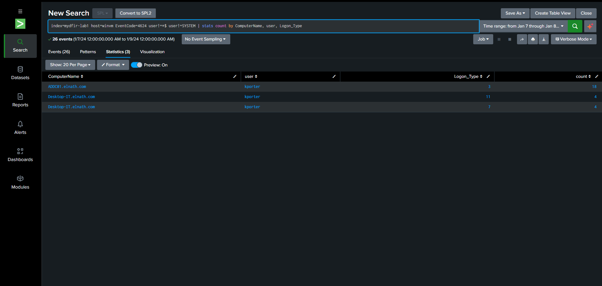](/images/Screenshot30.png)

*Screenshot 30*

Save this to a new Classic Dashboard titled **Windows Activity** with the panel name **Successful Logins by User**.

To monitor administrative logins, change the event ID to **4672** (*"Special privileges assigned to new logon"*):

[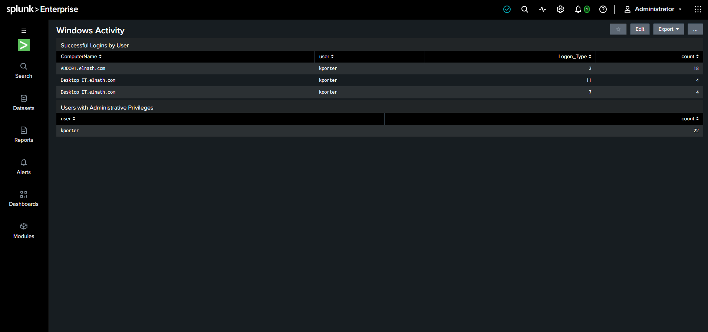](/images/Screenshot31.png)

*Screenshot 31*

To monitor new account creations (Event ID **4720**):

```spl
index=mydfir-lab1 host=winvm EventCode=4720 user!=*$ user!=SYSTEM 
| stats count by _time, ComputerName, Subject_Account_Name, New_Account_Account_Name
```

[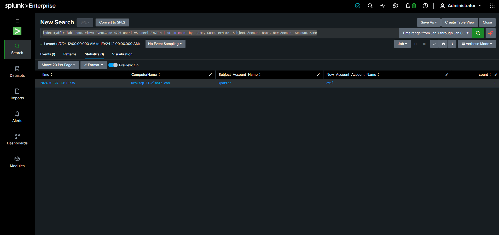](/images/Screenshot32.png)

*Screenshot 32*

Save this panel as **New User Account Created** under the **Windows Activity** dashboard. Audit controls on account creation help detect unauthorized persistence attempts.

---

## Setting Up & Formatting Alerts

To create an alert for successful SSH logins, return to the search query:

```spl
index=mydfir-lab1 host="linuxvm" source="auth.log" sourcetype=linux_auth_logs msg="Accepted password" 
| iplocation src_ip 
| stats count by _time, user, Country, src_ip
```

Map alerting logic back to the **MITRE ATT&CK** framework where applicable (e.g., **Initial Access - T1078**).

[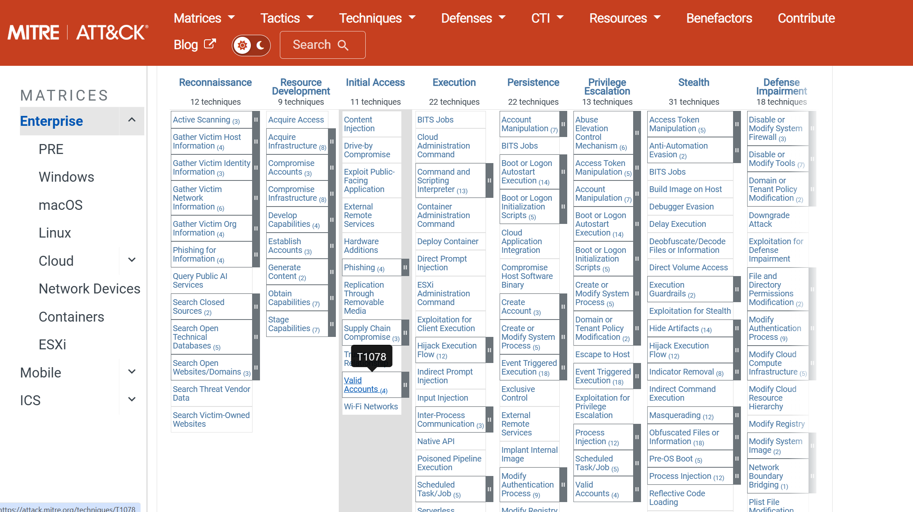](/images/Screenshot33.png)

*Screenshot 33*

* **Example Alert Title:** `Network - T1078 - Successful SSH Authentication`
* **Example Alert Description:** `Detect successful authentication activity towards our SSH server. Please utilize OSINT to obtain further context on the source IP address and look at what other activity the user/source IP has done.`

Configure a Cron Schedule to execute every 15 minutes (`*/15 * * * *`):

[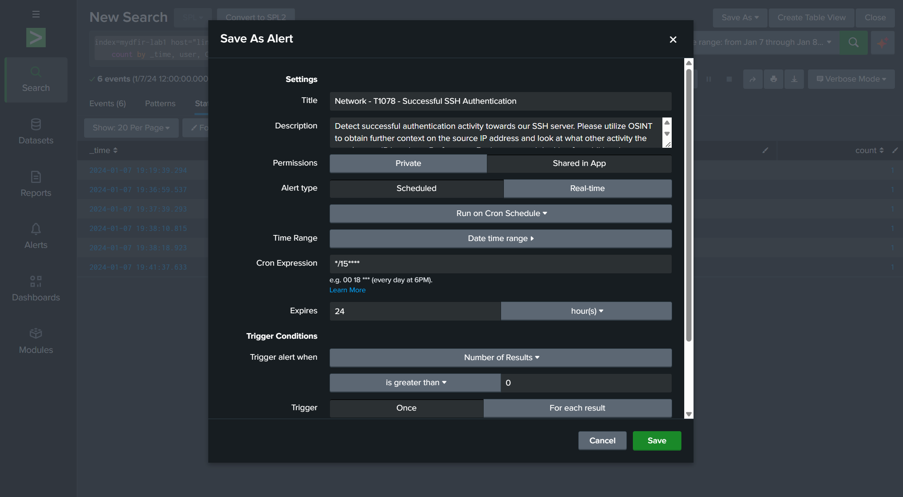](/images/Screenshot34.png)

*Screenshot 34*

Set the Time Range to **Every 15 minutes**:

[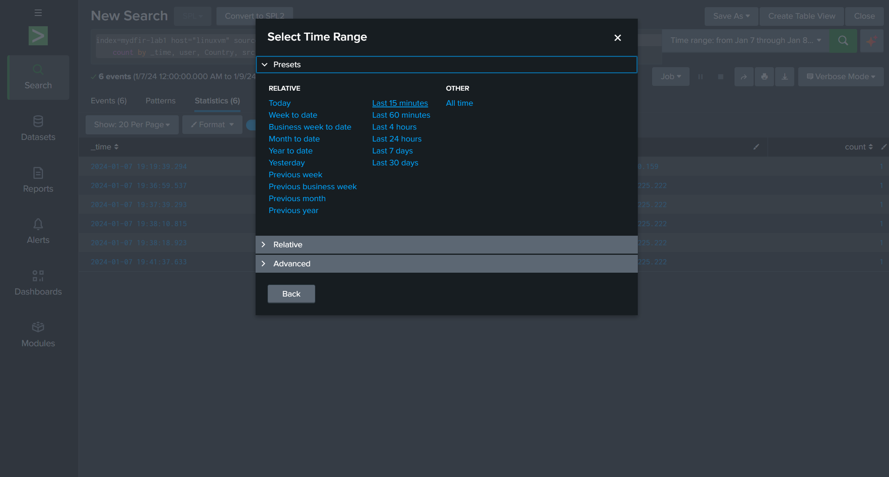](/images/Screenshot35.png)

*Screenshot 35*

Add trigger action: **Add to Triggered Alerts**.

[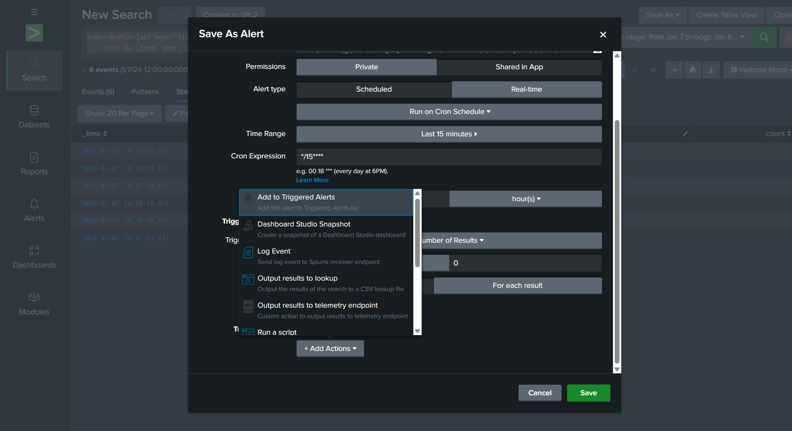](/images/Screenshot36.png)

*Screenshot 36*

Set severity to **Medium** and save.

[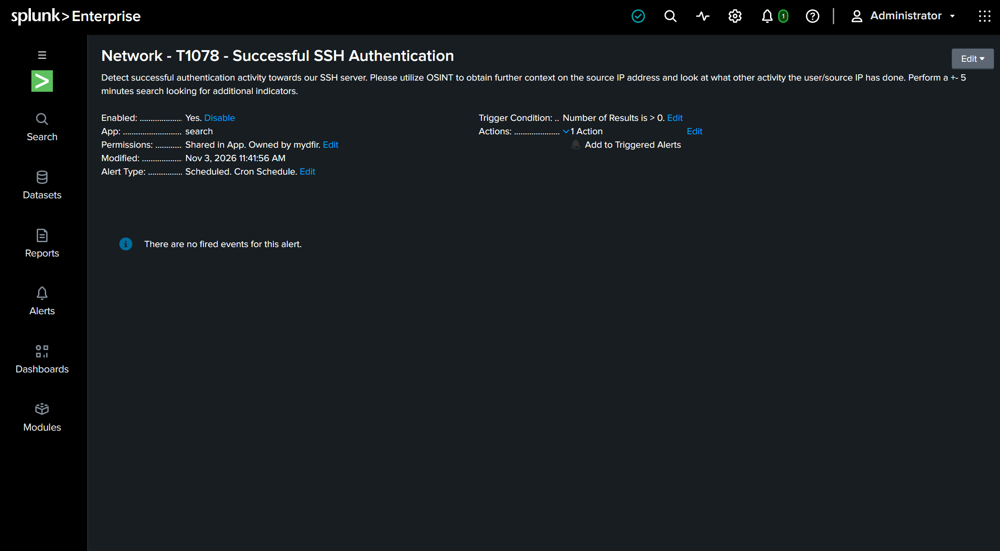](/images/Screenshot37.png)

*Screenshot 37*

---

## Creating Reports

Reports can be automated to run at designated intervals. To build a report showing the top 3 destination communications originating from the SSH server:

```spl
index=mydfir-lab1 src_ip=178.128.237.149 
| top limit=3 dest_ip
```

[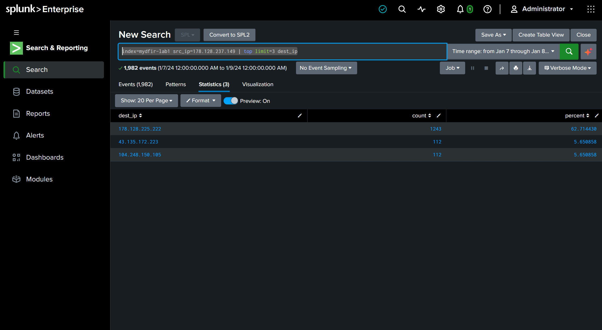](/images/Screenshot38.png)

*Screenshot 38*

Click **Save As ➔ Report**.
* **Title:** `Daily – SSH Server - Outbound Communication`
* **Description:** `A daily report that shows the top three destinations sourcing from our SSH Server. Review the destination IP to determine its legitimacy. Is the SSH server expected to communicate with this IP?`

[](/images/Screenshot39.png)

*Screenshot 39*

Configure the schedule to run daily at midnight.

[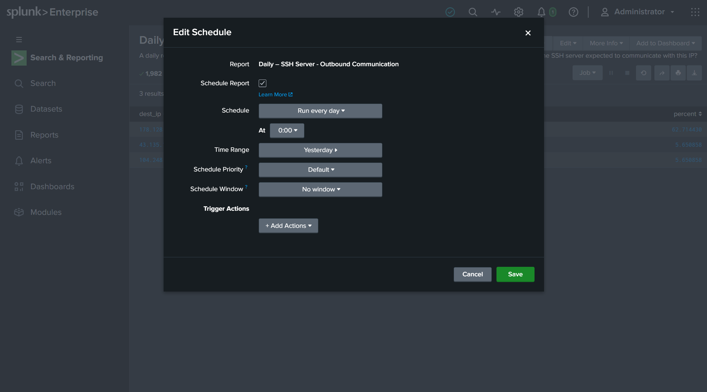](/images/Screenshot40.png)

*Screenshot 40*

[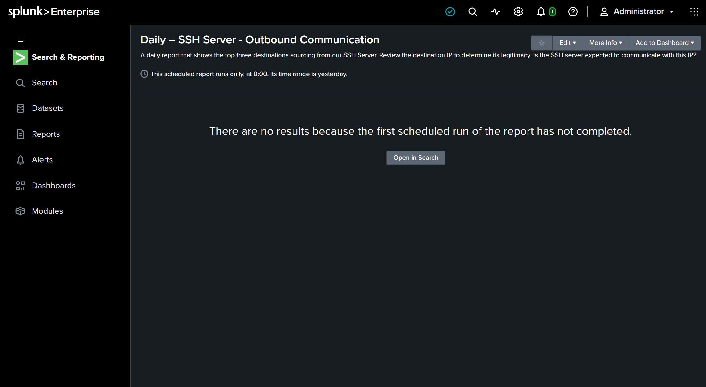](/images/Screenshot41.png)
*Screenshot 41*
